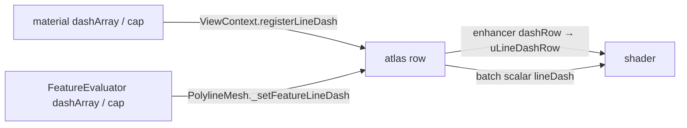

# Polyline Dash Patterns

A polyline's `dashArray` / `cap` are resolved to a **row of the view's line
dash atlas**, and the polyline fragment shaders cut each fragment against that
row. This guide covers the pieces a change must keep in step. For the option
semantics, see the docs page of the polyline material.

Core implementation: the patterns and the atlas rows in
`crates/navara_material/src/line_dash.rs`, the segment table in
`crates/navara_geometry/src/polyline/segment_table.rs`, the shader chunk
`shaders/glsl/chunks/line_dash_pars_fragment.glsl`, and the two polyline shader
pairs (`flatPolyline.*`, `polyline.*`). The Three.js frontend only uploads the
Rust-built data as textures (`web/navara_three/src/lineDash/`).

## From option to row

- `normalize_dash_array` turns the array into the dashes of one period, with
  MapLibre's `line-dasharray` rules: the period is the sum of the entries, a
  dash ending on the period boundary joins the one starting on it, zero-length
  dashes survive only with a round cap.
- The shader relies on the dashes being **sorted**: it finds the last dash
  starting at or before the point, and the point is either inside it or in the
  gap to the next one, whose two ends are the only candidates for the nearest
  dash end. The gaps are implicit, and the dashes on either side of the period
  come from the neighboring periods, so one distance is evaluated per fragment
  however many dashes the pattern has. MapLibre's line atlas uses the same
  partition, baked into a texture, as does the dash atlas of Rougier,
  [Shader-Based Antialiased, Dashed, Stroked Polylines](https://jcgt.org/published/0002/02/08/)
  (JCGT 2013), which stores the reference point per texel.
- `LineDashAtlas` holds one RGBA float texture's data per view, one pattern
  per row, deduplicated by array and cap. **Every `register` holds its row
  until a matching `release`**: a row number is stored per feature in batch
  textures, so a pattern never moves while it is in use. A mesh registers
  again only when its pattern changes, releases the row it replaces after
  registering the new one, and all of its rows when it is disposed; a row
  nobody holds is reused for the next new pattern. Releasing a row nobody
  holds is a frontend bug, which the atlas ignores with a warning. The Rust
  atlas reports a pattern it cannot hold (`LineDashRejection`) and the
  frontend draws it on row 0. The Three.js wrapper (exposed through
  `navara_wasm_api`) copies the data into a `DataTexture`; growth swaps the
  shared uniform's `.value`, so materials bind the uniform ref, never the
  texture.
- **Row 0 is a solid line with butt ends.** It is the atlas' reserved row, the
  batch scalar's allocation default, and the value the shaders skip. An array
  that cannot make a pattern resolves to it, unless the cap is round or square:
  the cap also shapes the line's own ends, so a solid line with one gets a row
  of a single dash that covers every period.
- A row's header carries the cap as a code (butt 0, round 1, square 2,
  `NVR_LINE_CAP_*`) and the middle of the pattern's longest gap.
- A material-level pattern sets the `NVR_LINE_DASH` define (part of the
  enhancer's program cache key). A per-feature one sets `USE_BATCH_LINE_DASH`
  through the batch texture, which then replaces the material's row for every
  feature of that mesh. A feature that sets only `dashArray` or only `cap`
  takes the other half from the material, so the mesh registers it again
  whenever the material's pattern changes, active or not: an inactive draped
  mesh is still a bake source.

## Distance along the line

The shaders need each fragment's distance along the line. The geometry builders
(`crates/navara_geometry/src/polyline/`) provide it per path:

| Path | Where | Unit |
| --- | --- | --- |
| Flat (draped) | `right_normal_and_line_length.z` from the clipped line's start, and `line_distance_and_ends.xy` (high, low) from the original line's start, per point | the tile-normalized units of `position` |
| Volume | per segment: length in `end_normal….w` (sign = side), length so far split into `start_normal_and_length_high.w` (high) + `right_normal….w` (low) | meters |

- **Flat**: vertices are shared between segments, so a closed ring's closing
  segment ends on copies of the seam vertices that carry the full length. The
  vertex shader converts distances to drape texels with the same
  `projectionMatrix[0][0]` factor that compensates the line width, so the
  pattern keeps its proportion to the width on an ancestor-tile bake.
- **Flat, original line**: the GeoJSON tiler records where each line it clips
  out of a longer one starts on it (`Ring::line_start`, `TileLine::start`),
  and `project_line_on_center` puts that distance in the first position's z.
  The flat builder adds it to the clipped line's own distance and splits the
  sum by `FLAT_LINE_DISTANCE_HIGH_STEP` into `line_distance_and_ends.xy`. A
  vector-tile (MVT) source has no such distance: its lines start at zero in
  every tile.
- **Volume**: the fragment splits the segment length by its distances to the
  start and end planes. Those are miter planes, so the vertex shader passes the
  factors (`nvr_vLineDashPlaneScale`) that turn a plane distance into a
  distance along the segment.
- **Volume segment table**: the geometry builder writes one entry per
  segment (`append_line_segment`: start high and start low with the length
  so far, end − start with the segment's position in its line, from the f64
  positions) into the RTE geometry's `line_segments`, which travels with the
  vertex buffers and which batching concatenates like them. The frontend
  wraps it in a texture that drops its CPU copy once uploaded
  (`createLineSegmentTextureReleasedOnUpload`). A fragment finds its entry
  from `gl_VertexID / 8`.
- The position in the line counts the segments before this one, so it is
  relative and survives concatenation: zero starts an open line, which is how
  the table separates the lines of a batched mesh, and a closed ring stores
  `−(n + 1)`, which tells its seam from two ends. From it a fragment finds
  its line's first segment and binary-searches the lengths so far, which
  increase along the line, for the segment holding any length.
- **Upload on first dash.** A line that is never dashed never uploads its
  dash data. The flat mesh keeps `line_distance_and_ends` off the geometry
  until it registers a pattern other than the solid row, or any per-feature
  one; the volume's segment table is sampled only by a dashed program, and
  Three.js uploads a texture on its first sampling draw.

## Line ends and caps

A line's own ends take the cap; the ends a tile clipped it at do not.

- **Flat: which ends are the line's own.** A drape bake draws several vector
  tiles into one terrain tile, and the pick bake does not cut each to its own
  square (the display bake clips it in the stencil), so a cap at a clip end
  would draw over the neighbor's line. Every vertex of a
  flat line therefore carries the line's length and which of its ends are its
  own, in `line_distance_and_ends.zw`. A tile clips its lines on or outside
  its own square, `[-1, 1]` in the positions' units, so only an end strictly
  inside the square is the line's own; an own end outside it is drawn by the
  tile it lies in, and a closed ring has none.
- **Flat: drawing the cap.** For a round or square cap, the vertex shader
  pushes the vertices at an own end half a line width out, extending the
  distance along the line with them, and the fragment shader cuts the cap
  from the distance past either end. No geometry is added for a cap.
- **Volume.** The boxes already reach half a width past each segment's
  planes; the fragment shader keeps that part only at an open line's first
  or last segment, which it reads from the segment table
  (`nvr_lineDashKeepsEnds`).
- **What a cap shows.** `nvr_lineDashDistance` takes the positions of the
  line's own ends along the pattern (`lineEnds`), and a dash that does not
  reach into the line is not drawn. A square cap takes the pattern at the end
  it continues, and a dash reaching an end has no edge there, so the cap
  carries it on at full opacity. Round dashes are cut to the line where they
  lie: a dot is drawn whole or not at all, and a dash crossing an end ends in
  a round cap centered on it, which is the line's own. The flat path knows
  its own ends from the line's length and end mask; the volume path looks
  them up in the segment table, only within a cap radius of a segment's
  planes.

## Period in the volume path

A pattern defined in line widths has no fixed length in meters: the width in
meters changes per fragment with the camera distance. `nvr_lineDashDistanceMeters`
therefore rounds the line width **up to a power of two meters** and lays the
pattern out in that unit. The pattern stays anchored to the line and is drawn
between one and two times the requested size, by the same factor for every
pattern, which is what MapLibre draws between two integer zoom levels.

**The power is chosen per period, never per fragment.** Chosen per fragment,
the switch falls on a curve of constant camera distance, a horizontal line
across a pitched view, and cuts every dash it crosses in two. The fragment
shader instead searches from two powers above its own, coarsest first, and
keeps the first power whose period (in that power's layout) starts where the
line is at least that wide. The period's start is read from the segment table
(`nvr_lineDashPointAt`), never from the fragment's own varyings, so every
fragment of a period gets one point whichever segment it lies in, and the size
changes only between periods. Ground lines' table positions lie on the
ellipsoid, so the point is lifted to the middle of the terrain's height range
under the line (`groundHeightRange`), a value the whole mesh shares. That is
not the volume's `minMaxHeight`: a mesh's volume also reaches below the
terrain to cover the curvature, which over a wide extent lifts the point far
underground and picks too coarse a size.

The width grows linearly with the eye depth, and the period's start lies
within one period along the line and within half the terrain's height range
of the lift.
That bounds the width at the start from both sides; where the bound already
decides a power's test, the fragment skips the table lookup. The bounds carry
a margin, so they only skip a lookup whose result they know, and every
fragment still reaches the same decision.

**Periods start in the middle of the pattern's longest gap.** The volume path
lays the pattern out from that point (`nvr_lineDashGapCenter`), so wherever two
periods take different sizes the change falls inside a gap and cuts no dash.
Period boundaries stay at multiples of the period for every power, which keeps
the search above consistent. A line drawn this way starts in the middle of a
gap; the flat path keeps MapLibre's start, with the first dash.

Two alternatives were measured and dropped:

- Rounding each pattern's *period* to a power of two keeps the phase exact on
  any line, but gives every pattern its own factor: two dash arrays can come
  out the same, and the ratio between two patterns changes with the view.
- Blending the two neighboring sizes (by signed distance, as MapLibre
  cross-fades over time) leaves a still view showing the half-morphed pattern,
  with every other dash shrunk, because the blend weight is a function of the
  camera distance, not of time.

The phase is `fract(length / period)`, and f32 cannot hold that quotient once
the line is thousands of periods long. The length so far is therefore stored
as `high + low` with `high` a multiple of `LINE_LENGTH_HIGH_STEP` (16384 m),
and the two halves are reduced separately:

- `high` is a whole number of steps and the period a whole number of
  `1 / DASH_PERIOD_STEPS_PER_LINE_WIDTH` line widths (`normalize_dash_array`
  rounds it, the atlas stores the count), times a power of two meters. So
  `high / period = steps * 2^e / periodSteps`, whose remainder
  `nvr_lineDashHighPhase` takes in 32-bit unsigned integers, exactly. The
  squaring in its power-of-two-modulo is why a period is capped at
  `MAX_DASH_PERIOD_STEPS`.
- `low` stays below one step plus one segment, which f32 divides by the period
  to within millimeters.

The tests of `line_dash.rs` mirror the shader functions in f32 and u32.

## Period in the flat path

A drape bake draws one terrain tile from several vector tiles, at the vector
tile's own level, a finer one or a coarser ancestor, and the terrain tiles
side by side can be at different levels. A pattern laid out from each clipped
line's start, as MapLibre does, then restarts at every vector tile edge and
takes a different phase on either side of a terrain tile edge, even along the
line.

The flat path therefore lays the pattern out along the original line
(`line_distance_and_ends.xy`), from its start, in a unit of the line width
rounded up to a power of two of the position's units (`nvr_vLineDashUnit`).
A drape level has
half the texel size of the one above, so the unit halves with it: the periods
of a finer bake keep every boundary of a coarser one, and the dashes of two
tiles at different levels line up, one size apart, without a cut at the tile
edge. The phase uses the same integer reduction as the volume path, with
`FLAT_LINE_DISTANCE_HIGH_STEP` as the step.

## Constraints

- **No `fwidth` at dash edges.** Dash distances are compared against an
  explicit pixel size: the period changes per fragment, which makes the
  distance discontinuous in screen space.
- **The volume discards, the flat path blends.** The volume path discards at
  the dash edge, like its line-width test. The flat path multiplies alpha,
  because the drape bake is always blended.
- **Gaps pick as the line.** The pick pass skips the dash test.
- **Every segment has a length.** A zero-length segment has no direction for
  its normals, and the shaders divide by its length. The flat builder drops
  consecutive positions that coincide in 2D. The volume builder drops a
  position whose wall bottom lies within `MIN_SEGMENT_LENGTH_METERS` (a
  millimeter) of the previous one's: the volume is built at fixed heights,
  so a vertical step would make a zero-length segment, and so would two
  coordinates of one point (longitudes ±180°, a pole).
- **Eight volume vertices per segment, in segment order.** A fragment reads
  its segment table entry at `gl_VertexID / 8`, and nothing checks that the
  entry is its own: the builder's vertex layout, and batching's
  concatenation of the vertices and `line_segments`, must keep the two in
  step.
- **The dash math uses the drawn width.** That is the width clamped to
  `maxWidth`, which is what the volume is built to. The ground fragment test
  cuts the volume to the same clamped width.
