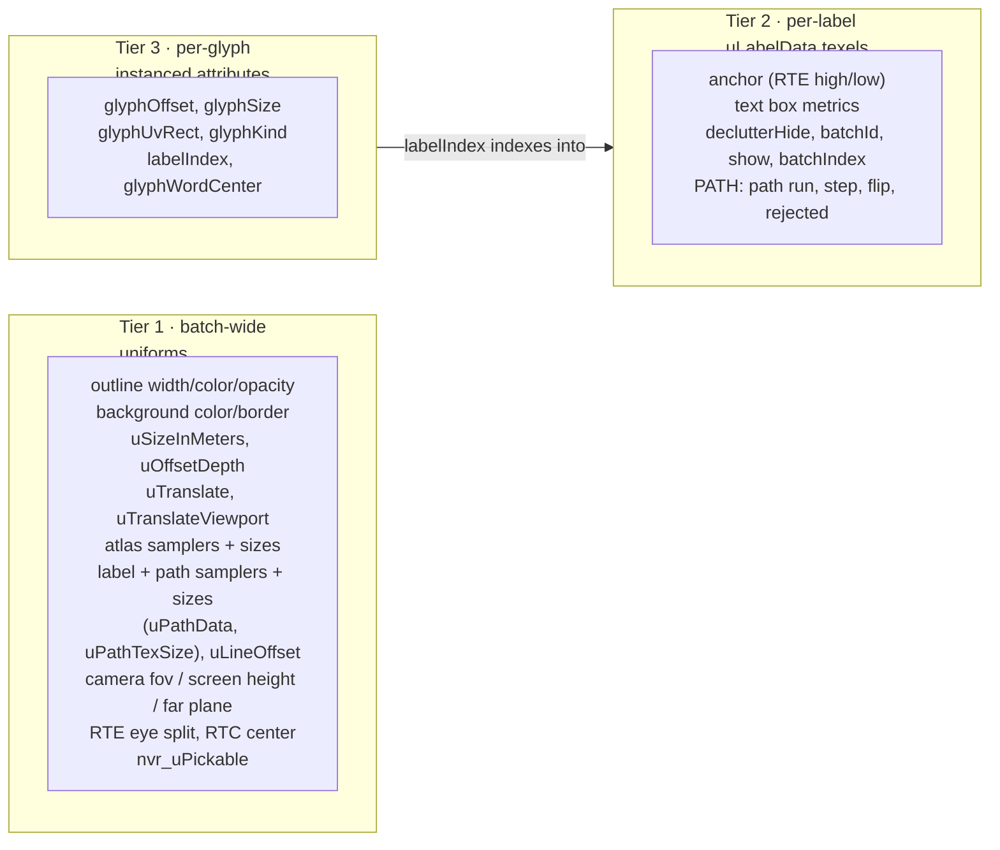

# Text Batching

How `@navaramap/three` draws every text label in a tile-layer with a **single
draw call**, and how a label can change its text without rebuilding the batch.
For how a label is placed and bent along a line, see
[LINE_PLACEMENT.md](LINE_PLACEMENT.md); for the placement pass that decides
which labels stay visible, see [DECLUTTER.md](DECLUTTER.md); for the broader
pipeline, see [ARCHITECTURE.md](ARCHITECTURE.md).

## Overview

One `BatchedSdfTextMesh` is created per Rust `TextMesh` event — i.e. per
tile, per layer (`event/features/text.ts`). It owns exactly one
`InstancedBufferGeometry` and one `ShaderMaterial`, and renders through one
`drawArraysInstanced(TRIANGLES, 0, 6, N)`: a shared unit quad, `N` instances.

**An instance is a glyph, not a label.** A tile with 60 labels averaging 5
glyphs each is one draw call with ~360 instances, not 60 draw calls.

That single-call constraint is the whole design pressure. A draw call is
bounded by one geometry plus one material, so anything that varies inside it
must be indexable per-instance. Uniforms are constant for the entire call —
which is why the batch's data is split three ways.

## The three tiers

Every value the shaders need falls into exactly one tier. Getting a value into
the wrong tier is the main way to break batching, so the split is worth
knowing before touching either shader.



Per-*feature* style — color, opacity, font size, height, orientation,
rotation — is not in any of the three. It lives in the shared batch data
texture, keyed by the feature index the label carries in `STATE.w` (see
[BATCH_TEXTURE.md](BATCH_TEXTURE.md)); a feature can own several labels
(MultiPoint, along-line repeats), so the label rows only hold what differs per
anchor.

**Tier 1** works because a batch is already keyed by `(font, quality)` and
built from one material — these were never actually per-label. Text quality is
immutable per batch for the same reason: all labels sample one atlas, so
flipping it requires a new batch.

**Tier 3** is ordinary instancing.

**Tier 2** is the interesting one: an instance is a glyph, but these values
vary per *label*, and a label owns many glyphs. The `labelIndex` attribute is
the join key — a foreign key from a glyph to its label's row block.

## The label data texture

Per-label state lives in an unfiltered `RGBAFormat` + `FloatType` `DataTexture`
that the **vertex** shader reads with `texelFetch`
(`mesh/sdfText/labelData.ts`). Five texels per label:

| row | x | y | z | w |
| --- | --- | --- | --- | --- |
| 0 `POSITION_HIGH` | anchor high .x | .y | .z | shift .x (em) |
| 1 `POSITION_LOW` | anchor low .x | .y | .z | shift .y (em) |
| 2 `BOX` | textWidth | *(reserved)* | bgMinY | bgMaxY |
| 3 `STATE` | declutterHide | batchId | show | batchIndex |
| 4 `PATH` | first texel of the path run | metres between samples | flip | rejected |

Rows 0–1 carry the RTE high/low anchor split (see
[RTC_VS_RTE.md](RTC_VS_RTE.md)); in RTC mode row 0 holds the tile-relative
position and row 1's `xyz` is unused. The layout is identical across both so
the shader's row indices never branch. Their `w` pair is the label's **shift**:
where its `anchor` and `offset` (both per label, since MapLibre's
`text-anchor`/`text-offset` are data-driven) move the block from its layout
origin, resolved on the CPU by `anchorShiftEm` against the layout's line box
(`LabelLayout.topEm`/`bottomEm`). An anchor change only rewrites the shift,
unless `textAlign: "auto"` makes the justification follow it, which re-lays out
the glyphs. A point label with `variableAnchors` is shifted by the one the
declutter pass placed it with (see [DECLUTTER.md](DECLUTTER.md#variable-anchors));
the record keeps every variable anchor's shift for the pass's candidate rows.
`STATE.w` is the feature index into the
batch data texture. `PATH` is all zero unless the label sits on a line (see
[LINE_PLACEMENT.md](LINE_PLACEMENT.md)).

Addressing is a linear texel index split by the texture's width, mirroring
`fogLight.frag.glsl`:

```glsl
vec4 nvr_readLabel(int slot, int row) {
    int i = slot * LABEL_ROWS + row;
    return texelFetch(uLabelData, ivec2(i % uLabelTexSize.x, i / uLabelTexSize.x), 0);
}
```

Only that linear index is an address: the width comes from the live
`uLabelTexSize`. So the texture is sized by the label count — the width is the
power of two at or above the square root of the texels it holds, keeping it
roughly square (16 labels are a 16 × 5 texture) — and a grow may widen it: the
buffer is copied over linearly, every label keeps its index, and the caller
refreshes `uLabelTexSize` along with the texture. Staying square is also what
keeps both sides under WebGL2's guaranteed 2048-texel limit (up to ~800k
labels), where a narrow fixed row would run out of height first. The path
texture (`uPathData`) shares this class, with its own wider stride.

`LabelRow` and `LABEL_ROWS` live with the **enhancer**
(`material/enhancer/sdfText/sdfTextBaseEnhancer/types.ts`), not with the
texture, because they are a shader contract: the enhancer injects `LABEL_ROWS`
as a GLSL define, so the CPU row table and the shader's stride cannot drift.
The individual row indices are restated in GLSL as `LABEL_ROW_*` defines;
`shader.test.ts` pins those against `LabelRow`, and that the rows form a dense
`0..n-1` range.

`setComponent` skips a write whose value is already stored, so a placement
pass that rewrites every label's unchanged decisions requests no upload.

> **Why a texture rather than replicating per-label values onto every glyph
> attribute?** Both render identically, but replication makes a per-label
> change cost O(glyphs). The declutter fade runs every frame; through the
> texture a fade step is one float per label regardless of glyph count. It also
> decouples the two allocations — when a text change relocates a label's glyph
> run, its label row does not move.

## Glyph runs and the slot allocator

Each label owns a **contiguous run** of glyph instance slots handed out by
`GlyphSlotAllocator` (`mesh/sdfText/glyphSlots.ts`). Run capacities are rounded
up to powers of two (floor 4), with a free list per size class.

This is what makes variable-length text cheap:

```ts
realloc(run, count) {
  if (run && capacityFor(count) === run.capacity) return run;  // same slots
  if (run) this.free(run);
  return this.alloc(count);
}
```

- **Same size class** (`"Paris"` → `"Lyon"`): the run is returned unchanged.
  The caller overwrites in place and blanks the leftover tail.
- **Class change**: the old run goes back to its free list, a new one is taken,
  and the vacated slots are blanked.
- Either way only that label's slots are rewritten, and the GPU upload is a
  `bufferSubData` of exactly that range via `addUpdateRange`.
- **Growth** doubles the buffers and is the only path that re-uploads
  everything. It is amortized O(1).

Worst-case internal fragmentation is 2×. That is the deliberate price of never
relocating a label that merely changed length; there is no compaction pass, and
none should be added without a measurement showing it matters.

`geometry.instanceCount` tracks the allocator's high-water mark, so the draw
covers holes left by freed runs as well as live runs. Both are blanked, which
is what the fourth `glyphKind` value is for.

## `glyphKind`

One float per instance encodes four roles (`GlyphKind` in
`mesh/sdfText/glyphBuffers.ts`, mirrored by the `GLYPH_KIND_*` defines in
`sdfText.vert.glsl`):

| value | meaning |
| --- | --- |
| `0` SDF | sample the single/multi-channel SDF atlas |
| `1` COLOR | sample the COLRv1 RGBA atlas — lets one batch mix text and emoji |
| `2` BACKGROUND | one strip of this label's background (see below) |
| `3` EMPTY | unused tail of an over-allocated run, or a hole from a freed run |

`EMPTY` is culled on the first line of `main()`, before any texture read. New
buffer capacity is explicitly filled with `EMPTY`: a zero-filled array would
read as `SDF` and draw garbage quads.

`BACKGROUND` always occupies the first slots of the run, so a label's
background is submitted before its own glyphs. The fragment shader's
outline-seam fix depends on that ordering. Whether it actually draws is a
batch-wide `uShowBackground` test in the shader, so toggling backgrounds costs
no buffer writes.

The background is `backgroundSliceCount(glyphs)` strips rather than one quad,
so a flat label's box can bend with the globe (see
[Quad orientation](#quad-orientation)). Each strip stores its span of the box
as `[0, 1]` fractions, the start in `glyphOffset.x` and the **end** (not a
width) in `glyphSize.x`, so neighbouring strips share bit-identical edges. The
vertex shader remaps `vAtlasUv.x` to that span, and since the fragment shader
draws fill and border from the UV alone, the split is pixel-identical to a
single quad.

## Quad orientation

A glyph's vertex position is its unit quad offset from the label's anchor **in
view space**: `mvPosition + vec4(localPos.x * right + localPos.y * up, 0.0) *
scaleFactor`. All four orientation modes differ only in that `(right, up)`
pair, which `nvr_quadOrientation` resolves from two booleans that mirror
MapLibre's two alignments — `uFlatFacing` picks the plane (`text-pitch-alignment`:
screen or ground), `uRotateWithCamera` what the quad turns with inside it
(`text-rotation-alignment`: the camera or the map):

| `uFlatFacing` | `uRotateWithCamera` | right, up | behaviour |
| --- | --- | --- | --- |
| `false` | `true` | view `+x`, `+y` | screen-aligned billboard (the default) |
| `false` | `false` | east's heading on screen, its screen perpendicular | on screen, turned with the camera heading so x points east |
| `true` | `true` | screen `+x` projected onto the tangent plane | lies on the surface, yawed to keep reading left-to-right |
| `true` | `false` | east, north | lies on the surface, pinned north-up |

A zero-Z offset is exactly what makes a quad screen-aligned, so both upright
rows have zero-Z axes; the flat rows rotate a *world* direction into view space
(`viewMatrix * vec4(dir, 0.0)`, the idiom `mvr_getMvHeightOffset` already uses).
The surface normal is `normalize(absTransformed)` — the same spherical
approximation as the height offset, reusing the ECEF position horizon culling
already reconstructed.

The upright map-aligned row measures the camera heading β (clockwise from
north) in the tangent plane: `t`, screen right projected onto it as in the flat
yawed row, is `cos β · east − sin β · north`, so `right = (t·east, −t·north, 0)`
and `up` is its screen perpendicular. That turns the label by the bearing
alone, independent of pitch, exactly as MapLibre's `rotateInShader` turns a
`map`/`viewport` label, and it is unit length without normalizing.

Facing and `rotateWithCamera` arrive already resolved: a material leaving
either unset gets MapLibre's `auto` (`rotateWithCamera` follows the camera only
for point placement; facing is flat exactly when map-aligned), applied on the
CPU by `resolveOrientation` (`material/orientation.ts`) wherever the meshes
read the material.

The orientation resolver lives in `chunks/quad_orientation.glsl`, shared with
`instancedSprite.vert.glsl` so labels and sprites cannot drift apart. It takes
the two booleans and the rotation as **parameters** rather than reading
uniforms, which is what lets them arrive either way — see below.

**These three are per-feature, not batch-wide.** The uniforms
(`uFlatFacing`, `uRotateWithCamera`, `uRotation`) are only the material-level
default: the shader seeds its locals from them, then
`chunks/batch_texture_vertex.glsl` overwrites those locals from the batch data
texture when a feature has its own value (see
[BATCH_TEXTURE.md](BATCH_TEXTURE.md)). The two booleans share one texel
component through `packOrientation`, the same trick `showOpacity` uses.

One subtlety this forced: `USE_BATCH_*` is a **material-wide** define, so the
moment one feature is given its own rotation, every feature starts reading the
slot. Features nobody styled must therefore already hold what the uniform was
giving them, which is why `ensureRotationSlot` / `ensureOrientationSlot`
backfill from the material's current value instead of a fixed constant. The
mesh supplies those values as a typed `BatchAttributeDefaults` argument to
`updateBatchAttribute` (`ensureShowOpacitySlot` does the same with
`material.visible`).

`nvr_quadBasis` then spins that basis by the rotation (converted from the material's
degrees to radians CPU-side) **inside the quad's own plane**, turning both axes together. Because it composes with the resolved
basis rather than replacing it, one implementation covers every mode: it spins
a billboard on screen and swings a surface label like a compass bearing, and
the quad never leaves the plane its mode put it in. The sine is negated
relative to the usual counter-clockwise matrix so a positive angle reads
clockwise from in front, matching compass bearings and MapLibre's
`text-rotate`.

The pivot is the **anchor**: glyph offsets are measured from it once the
label's shift has moved the text block, so `anchor` (and `offset`) decide where
inside the text the label turns about — `"center"` spins it about its middle,
`"bottom"` about the bottom of the block.

Flat labels are then **wrapped onto the globe** by `nvr_quadOffset`: each
vertex's tangent-plane offset is walked the same distance along the great
circle it points down (the sphere's exponential map), instead of being added
as a straight line. A tangent plane touches the surface only at the anchor and
rises off it as `d² / 2R`, which is nothing for a street-scale label, but a
pixel-sized label seen at globe scale can be thousands of kilometres wide, and
its ends would otherwise float off the surface and past the limb. The bend is
per vertex, so every quad remains a flat chord between its bent corners. For a
glyph that chord is short enough to ignore, but a single background quad would
stay straight while the text above it curved, so the text rose out of its box
in the middle. The background is therefore drawn as side-by-side strips, one
per two glyphs and capped at 8 (`backgroundSliceCount`), each about glyph-wide
and bending the way the glyphs do.

Strips and glyphs are still chords with *different* endpoints, so they are no
longer exactly coplanar, and glyph outlines only draw over the background
because they share its depth (see the depth notes in `sdfText.frag.glsl`).
Wherever a glyph dipped below its strip, the outline lost the depth test and
the background showed through it. A flat label's strips are therefore pushed
back along the view ray by twice their chord's sagitta (`s² / 4R`, added to
`vFragDepth` in meters), which bounds the mismatch. The push is zero for upright
labels and negligible at street scale.

> **Never derive a screen-plane axis by projecting a world direction onto the
> screen.** An earlier revision gave the screen-plane quad an up vector of
> *north projected onto the screen*, whose direction is undefined outright when
> north lies along the view axis — the camera level and looking north. The
> heading above is instead measured in the tangent plane, from the same
> projection the flat yawed row uses, so it degenerates only where the normal
> points along screen x, the one case that row already handles. Reading upside
> down when the camera faces south is not a fault of it: it is what aligning
> with the map means, for the flat north-up row and MapLibre alike.

Consequences worth knowing:

- **The background strips share the basis and the bend**, so the box stays
  on the same surface as its glyphs in every mode.
- **The batch material is `DoubleSide` by default**, as is
  `InstancedSpriteMesh`'s. The material's `backfaceCulling` option switches
  both to `FrontSide` (the enhancer's `updateMaterialProps` owns `side`).
  Only a flat quad can show its back: its front faces away from the globe, so
  the triangles of a large flat label or sprite that wrap over the horizon
  face away from the camera, and culling trims it at the limb one triangle at
  a time (horizon culling itself only tests the anchor). An upright quad lies
  in the screen plane and never presents a back face, and
  `screenSpaceNormal()` in both fragment shaders already flips an away-facing
  normal before it reaches the G-buffer.
- **A point label's declutter box is its unrotated block.** The Rust kernel
  projects the anchor and scales the label's em box by pixels-per-meter
  (`crates/navara_wasm_api/src/declutter.rs`), ignoring the basis above. That
  over-estimates a foreshortened flat label, which is conservative, but
  follows neither `rotation` nor the heading an upright map-aligned label is
  turned by: a turned label can overrun its box. Line
  labels are the exception — the line-placement pass hands declutter the
  rotated box they actually cover (see [LINE_PLACEMENT.md](LINE_PLACEMENT.md)).
- **A label bent along a line skips this basis.** Its axes come from the line
  under each word, except for spread glyphs following the camera, and a
  straight label (`rotateWithCamera` without `spreadGlyphs`) lays out exactly
  as a point label (see
  [LINE_PLACEMENT.md](LINE_PLACEMENT.md#drawing-along-a-line)).

## Picking

`sdfText.frag.glsl` deliberately does **not** include
`chunks/batch_definition.glsl`, which declares `nvr_uBatchId` as a uniform —
that only works when one material draws one feature. The batch id instead
travels per-label (`STATE.y`) into a `flat varying vBatchID`, the same approach
`instancedSprite.frag.glsl` takes. `nvr_uPickable` stays a uniform because pick
mode is batch-wide.

## Gotcha: three caches the instance ceiling

> three.js sets `geometry._maxInstanceCount` on the **first** VAO bind (guarded
> by `=== undefined`) and only clears it when the geometry is *disposed*. Every
> draw then clamps to `min(geometry.instanceCount, geometry._maxInstanceCount)`.

Replacing instanced attributes with larger ones — the normal way to grow a
pooled instance buffer — does **not** raise that ceiling. Without intervention
a batch stays pinned to whatever capacity it had when it was first rendered,
and every label added afterwards silently never draws.

`GlyphBuffers.ensureCapacity` therefore deletes the cached field after growing.
There is no public API for this; deleting it is what three itself does on
dispose.

This fails silently — no console error, `geometry.instanceCount` reads correct
on the JS side, and the draw call is still issued. The symptom that identifies
it: content renders correctly when the object is **recreated** (its buffers
grow before the first render) but not on the original load path. Confirming it
requires reading the instance count at the GL level, e.g. patching
`drawArraysInstanced` and logging its last argument.

## Constraints and trade-offs

- **Draw order.** Labels paint in slot order, not three's back-to-front
  transparent sort. `depthTest` + `depthWrite` + the fragment shader's
  `gl_FragDepth` writes resolve overlaps, and decluttered labels do not overlap
  by construction. Only overlapping labels with `depthTest: false` *and*
  declutter off are affected. MapLibre and deck.gl make the same trade.
- **`frustumCulled` stays `false`.** Geometry positions are unit quads and the
  real transform happens in the shader, so a three.js bounding sphere would be
  meaningless. Horizon culling in the shader covers the far side of the globe.
- **Labels are created lazily** on the first per-feature setter, keyed by a
  sparse `batchIndex → label` map. MVT tiles routinely carry thousands of
  features where only a handful get text; sizing eagerly to the anchor count
  would waste hundreds of KB per tile.
- **A changed material field overwrites per-feature style.** Engine change
  events re-send the whole material, so `_applyUpdate` compares against the
  previous one and writes only the fields that actually changed to every
  label, clobbering evaluator overrides for those fields alone.

## Key files

| File | Role |
| --- | --- |
| `shaders/glsl/sdfText.vert.glsl` | `nvr_readLabel`, the `GLYPH_KIND_*` culls, RTE/RTC transform |
| `shaders/glsl/chunks/quad_orientation.glsl` | `nvr_enuBasis`; `nvr_quadOrientation` / `nvr_quadBasis` — the orientation basis; `nvr_quadOffset` / `nvr_wrapOffset` — the vertex offset, wrapped onto the globe when flat. Shared with instancedSprite |
| `shaders/glsl/sdfText.frag.glsl` | SDF/MTSDF and COLRv1 sampling, outline, background, pick encoding via `vBatchID` |
| `web/navara_three/src/mesh/sdfText/batchedSdfText.ts` | `BatchedSdfTextMesh` — label records, the engine/evaluator API, declutter participation, atlas retain/release |
| `web/navara_three/src/mesh/sdfText/glyphBuffers.ts` | Instance attributes, partial uploads, capacity growth, `GlyphKind` |
| `web/navara_three/src/mesh/sdfText/glyphSlots.ts` | `GlyphSlotAllocator` — size classes, free lists, `realloc` |
| `web/navara_three/src/mesh/sdfText/labelData.ts` | `LabelDataTexture` — addressing, writes, growth; also backs the path texture |
| `crates/navara_wasm_font_worker/src/shaping.rs` | Shaping, plus every fact layout derives from the source text: line-break classes, cluster continuation, per-line direction (`DIRECTION_*`; neutral runs defer to the line's first strong glyph, since family fallback shapes digits/punctuation apart), `allows_letter_spacing`. Layout never inspects the string itself |
| `web/navara_three/src/mesh/sdfText/layout.ts` | Pure layout: line breaking, letter spacing, shaping result → glyph quads, word centres |
| `.../enhancer/sdfText/sdfTextBaseEnhancer/types.ts` | Batch-wide props/state/refs, plus `LabelRow` / `LABEL_ROWS` (the shader contract) |
| `web/navara_three/src/event/features/text.ts` | Creates one batch per Rust `TextMesh` event |
| `web/navara_three/src/mesh/sprite/instancedSprite.ts` | The sibling batched mesh; text follows its conventions |
